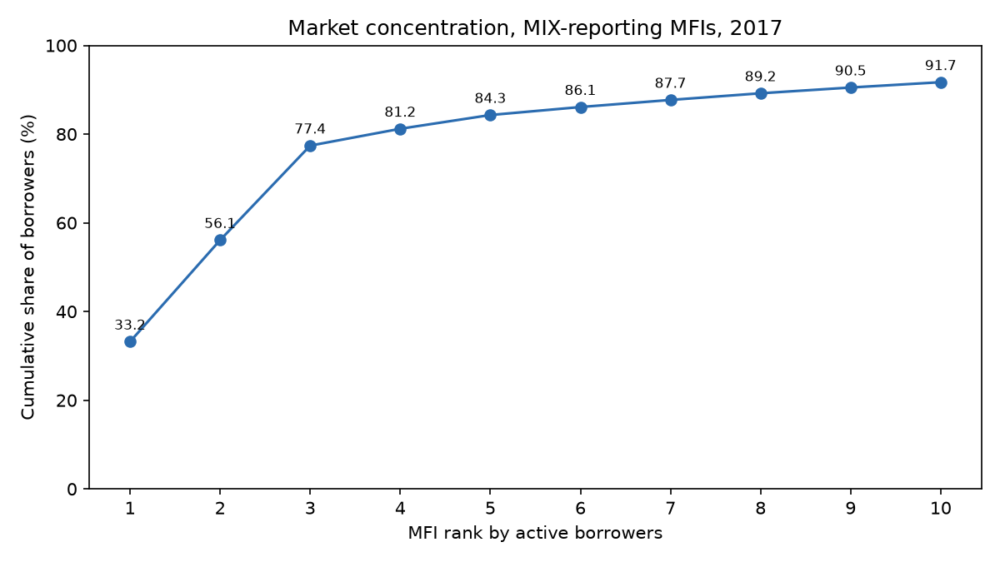
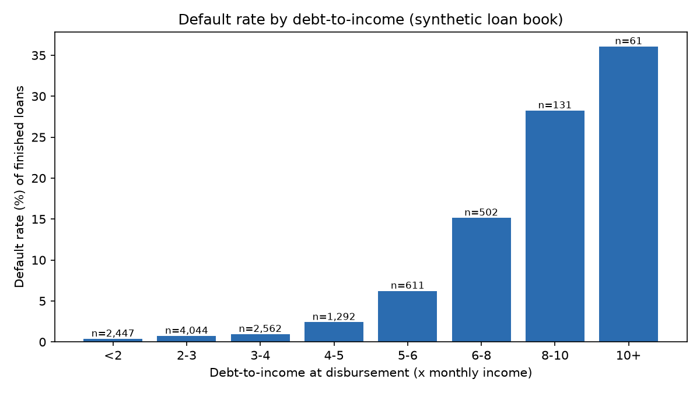

# Bangladesh MFI Loan Analysis

Bangladeshi microfinance institutions (MFIs) report loan recovery rates around 98%. This SQL project asks two questions: **at what debt-to-income ratio do borrowers start defaulting, and can loan stacking (one borrower juggling loans from several lenders) be detected?**

Stack: PostgreSQL, Python (pandas, numpy, matplotlib).

## What is real and what is synthetic

| Part | Data | Source |
|---|---|---|
| 1 | **Real**: 695 MFI-year records for 86 Bangladeshi MFIs, 1999-2019 | MIX Market (World Bank Data Catalog), self-reported by MFIs |
| 1 | **Real**: headline sector figures, FY2019-FY2024 | MRA statistics as reported in news coverage, hand-entered with a source URL per row |
| 2 | **Synthetic**: 10,000 borrowers, 12,404 loans, 521,354 weekly installments | Generated by `scripts/generate_*.py` (fixed random seeds) |

No real borrower data was used. Every parameter of the synthetic book (income, loan size, term, interest, stacking rate, default rule) is an **assumption** set at the top of the scripts. Lender names are generic (Lender A to E).

## Key findings

### Part 1: the real sector (MIX Market, MFIs that reported)

- **Concentration:** in 2017 the top 3 MFIs (Grameen Bank, ASA, BRAC) held **77.4%** of active borrowers and the top 10 held **91.7%**. Headline repayment rates are mostly the repayment rates of three institutions.
- **Loan size:** the portfolio-weighted average outstanding balance in 2017 was about **$293** per borrower, ranging from about $190 to $460 across the ten largest MFIs.
- **Growth:** like-for-like growth in loan portfolio (same MFIs in both years, US dollars) ranged from **4.4% to 24.2% a year** between 2008 and 2017.

### Part 2: the synthetic loan book

- **Headline vs. hidden risk:** installments are collected at **98.72%** of the amount due, yet **6.0% of finished loans (debt-to-income of 6 or more) produce 50.8% of all defaults**.
- **Where defaults jump:** default rates stay below 1% until debt reaches about 4 months of income, rise to 2.4% at 4-5, 6.2% at 5-6, and 15.1% at 6-8.
- **Repayment looks perfect early:** in weeks 1-13 every monthly cohort collected 99.6% to 100%, while weeks 14-26 fell to between 97.5% and 99.7%. A repayment rate measured early in a loan's life flatters the portfolio.
- **Loan stacking:** counting lenders per borrower flags every stacker but also 1,323 innocent borrowers (precision 38.5%). Checking that loans from different lenders **overlap in time** found all 828 stackers with no false alarms.
- **Stackers default more:** 7.20% vs 1.38% for other borrowers.

| DTI bucket | Finished loans | Defaults | Default rate |
|---|---|---|---|
| under 2 | 2,447 | 9 | 0.37% |
| 2 to 3 | 4,044 | 29 | 0.72% |
| 3 to 4 | 2,562 | 24 | 0.94% |
| 4 to 5 | 1,292 | 31 | 2.40% |
| 5 to 6 | 611 | 38 | 6.22% |
| 6 to 8 | 502 | 76 | 15.14% |
| 8 to 10 | 131 | 37 | 28.24% |
| 10 and over | 61 | 22 | 36.07% |

### Important: what Part 2 does and does not show

The relationships in Part 2 are **built in**. Default risk in the generator depends on debt-to-income, and stackers were planted with overlapping loans. So these results demonstrate that the SQL **recovers a planted structure** (a threshold and a set of stackers) and shows the method. They are **not discoveries about real Bangladeshi borrowers**. The perfect detection score reflects a clean generator; real data would have messy dates, no shared borrower IDs across lenders, and legitimate multiple borrowing.

## Limitations

- **MIX Market** is self-reported and stops in 2019. The number of reporting MFIs changes by year (28 to 40), so yearly totals partly reflect who reported; growth is therefore measured on the same MFIs in both years. 2018 is unreliable (Grameen has no 2018 row; BRAC's 2018 borrower count is blank). Figures are in US dollars. Some MFIs have fiscal years ending in June.
- **MRA figures** are hand-entered from news reports, not the original statistics, and FY2022 is missing. Sources disagreed on units in one case (2.49 trillion taka reported as "2.49 billion"); the Dhaka Tribune figure was used and cross-checked against FY2024 growth.
- **Right-censoring:** active loans are excluded from default rates because their outcome is unknown, which slightly overstates default rates (2.28% among finished loans vs 2.14% overall).
- **Small samples:** the top DTI bucket has only 61 loans, so its rate is imprecise. Differences between monthly cohorts are mostly noise (roughly 12 to 15 defaults per cohort).
- **Not verified:** loan sizes and lender sizes were chosen with the Part 1 benchmarks in mind but were not fitted, and the synthetic average outstanding balance has not been checked against the $293 figure.
- **MIX cleaning** was done interactively in Python. The cleaned CSV is committed; the raw files are not (see `docs/data_sources.md`).

## How to reproduce

1. Create a PostgreSQL database named `mfi_portfolio`.
2. Run `sql/part1_sector/01_create_tables.sql` and `sql/part2_loanbook/01_create_tables.sql`.
3. Load `data/clean/mix_bangladesh_annual.csv` and `data/clean/mra_sector_yearly.csv` with psql `\copy`.
4. Run, in order: `scripts/generate_data.py`, `scripts/generate_loans.py`, `scripts/generate_payments.py` (the last one rewrites `loans.csv` with outcomes and writes `payments.csv`, which is not committed).
5. Load into Postgres in this order: `lenders`, `borrowers`, `answer_key`, `loans`, `payments` (all in `data/synthetic/`).
6. Run the queries in `sql/part1_sector/02` to `05`, then `sql/part2_loanbook/02` to `07` (`04_dti_view.sql` must run before `05_default_by_dti.sql`).

The `answer_key` table holds the hidden stacker labels. It is read only to score detection queries, never by the detection logic itself. The schema is in `docs/schema.md`.

## SQL techniques used

Window functions (`SUM() OVER`, `RANK`, `LAG`, running totals), CTEs, self-joins on date overlap, `CASE WHEN` bucketing, `FILTER` aggregates, views, `date_trunc`, foreign keys and `CHECK` constraints.
