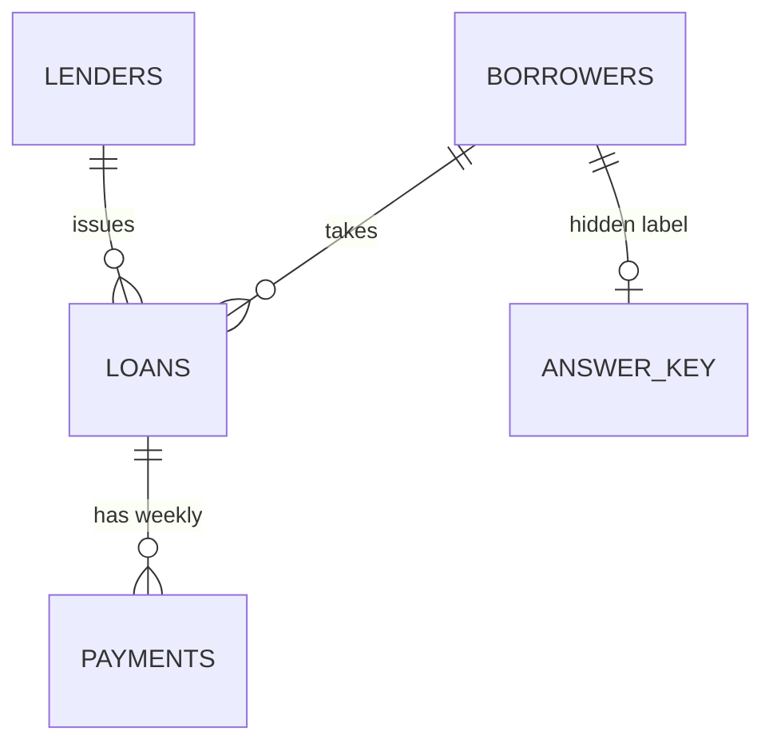

# Loan book schema

- `answer_key` marks which borrowers were generated as loan stackers. Detection queries never read it; it is only used to score them.
- Debt-to-income = total principal of a borrower's active loans / monthly income.
